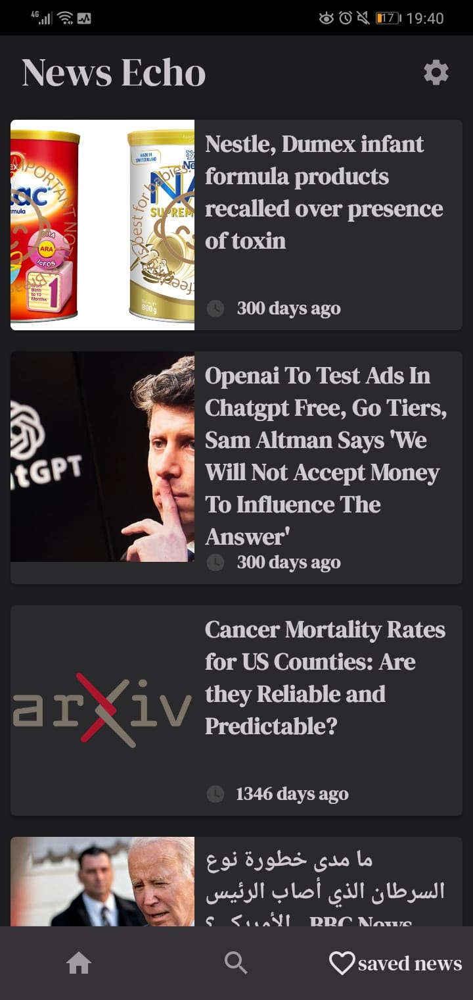
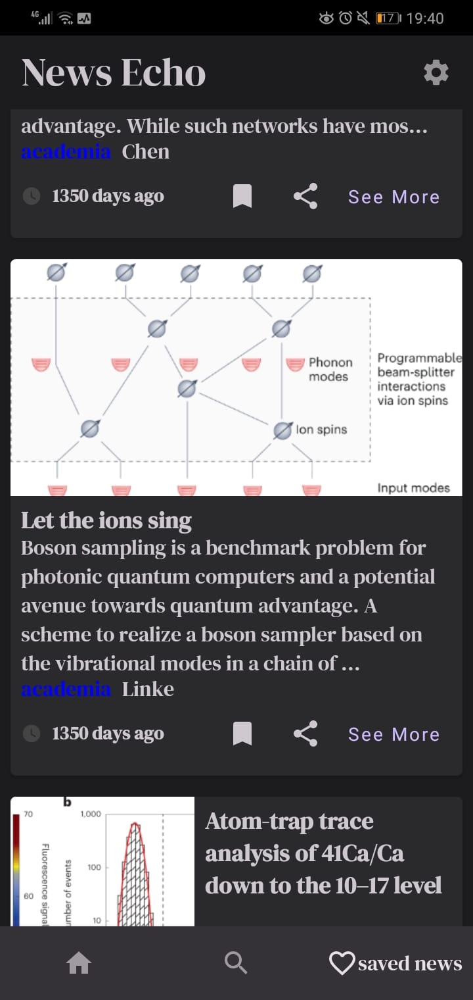
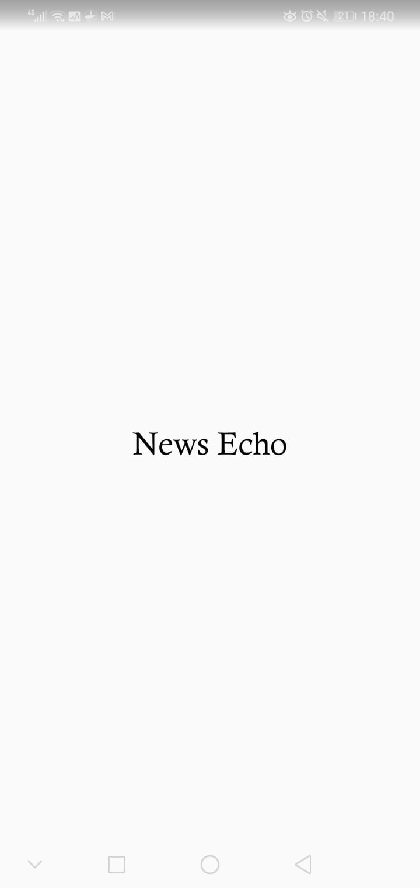

# News Echo

**News Echo** is a native Android news application developed in **Kotlin** as an independent learning project. I built it while studying Android development through Google's official Android learning resources and documentation.

The project gave me practical experience developing a mobile interface, integrating a news API, and organising news content into an app that users can browse and search.

## Features

- **News feed:** Browse articles with headlines, preview images, and publication information.
- **News categories:** Explore articles across different topics.
- **Search:** Find news articles using a search interface.
- **Article previews:** View article summaries and related details.
- **Saved news:** A dedicated saved-news area, with bookmark controls visible in the interface.
- **Sharing:** Article-sharing controls.
- **Dark interface:** A dark-themed reading experience.

> Feature descriptions reflect the original project and available screenshots. Some details of the underlying implementation have not yet been documented.

## Technologies

- **Language:** Kotlin
- **Platform:** Native Android
- **Data source:** News API integration (provider to be confirmed)
- **Learning resources:** Official Android developer documentation and tutorials

## Screenshots

| News feed | Article list | Splash screen |
| --- | --- | --- |
|  |  |  |

## Background and learning outcomes

I developed News Echo as a self-directed project to apply what I was learning about native Android development. It helped me practise Kotlin, API integration, displaying remote content, and designing mobile screens.

This was an early project. Later, during the **ALX Software Engineering programme**, I learned more about project organisation, documentation, and maintainable software development practices. I have added this README retrospectively to document the work more clearly.

## Running the project

The original project setup has not yet been verified. If you want to run it locally, first inspect the repository's Android project configuration and any API-key requirements. Add confirmed setup steps here once they have been tested.

## Project status

**Personal learning project.** This repository documents an application built during my independent study of Android development. The screenshots show the application at the time of development; they do not establish current API availability or compatibility with recent Android versions.

## Author

**Ali EL Moussaoui**  
[GitHub profile](https://github.com/AliMoussa-00)
